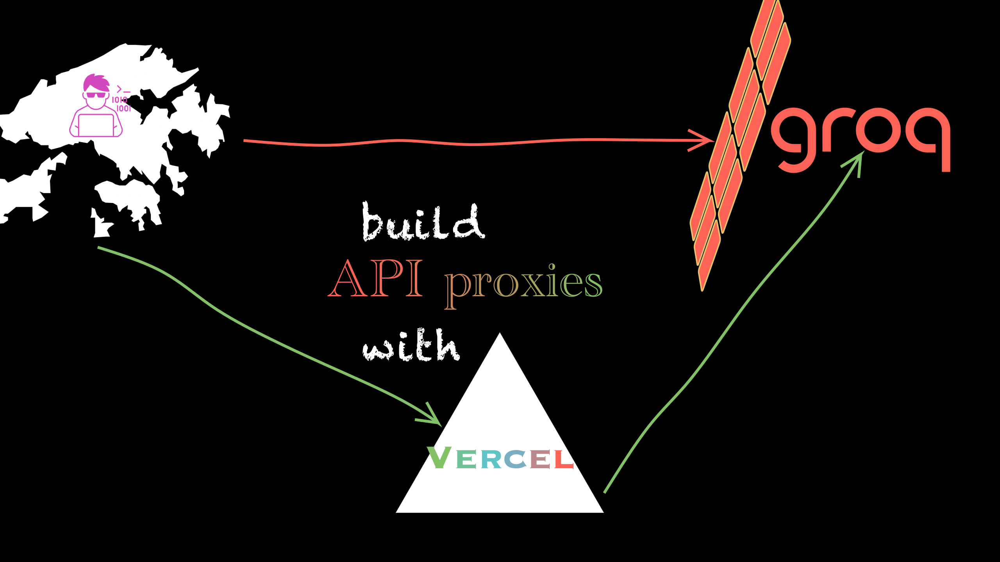

<!-- todo:
1. change icon
2. one-click deploy
3. support cerebras
-->

<p align="center">
 
 <h2 align="center"> LLM API 反向代理 </h2>

<p align="center">
  <a href="https://github.com/ultrasev/llmproxy-vercel/issues">
    
  </a>
  <a href="https://github.com/ultrasev/llmproxy-vercel/pulls">
    
  </a>
  <br />
</p>

本项目旨在提供一个反向代理服务，解决在部分国家或地区无法直接访问 Google, Groq, Cerebras（Amazon cloudfront）等平台 API 的问题。

# 功能

通过 Vercel 边缘网络，反向代理 OpenAI、Groq、Google、Cerebras 等平台的 API 请求。

- 支持供应商：Groq、Google、OpenAI、Cerebras、NVIDIA、Mistral、Sambanova
- 支持流式输出
- 兼容 OpenAI API 规范
- Gemini 支持原生 Grounding with Google Search（服务端检索 + 引用返回），并提供原生 `generateContent` API 透传

注：大陆不可直接访问 vercel.app 域名。如想直接访问，可参考之前作者的另一个项目[llmproxy](https://github.com/ultrasev/llmproxy)，通过 cloudflare worker 部署 LLM API 反向代理。

# 使用
部署到 Vercel 后，可使用自己的 API 地址为：https://your-project-name.vercel.app/。
测试 API 地址：
- https://llmproxy-vercel.vercel.app/ : 即 vercel 提供的 API 地址，局域网内不能直接访问，需科学上网。
- https://llm.cufo.cc/ : 作者通过 cloudflare + 美区 VPS 搭建的反向代理，大陆等地区可直接访问，调用路径为 local -> CF(HK) -> VPS(US) -> OpenAI。

两个地址使用时均不需要携带 `/v1` 后缀，即 `base_url="https://llm.cufo.cc/openai"` 或者 `chat_url="https://llm.cufo.cc/openai/chat/completions"`。

## 示例 1： OpenAI

```python
from openai import OpenAI

client = OpenAI(
    api_key="sk-proj-...",
    base_url="https://llmproxy-vercel.vercel.app/openai", # 没有 /v1 后缀
)

response = client.chat.completions.create(
    model="gpt-3.5-turbo",
    messages=[{"role": "user", "content": "Hello world!"}],
)

print(response.choices[0].message.content)
```

## 示例 2： Google Gemini

```python
from openai import OpenAI

client = OpenAI(
    api_key="...",
    base_url="https://llmproxy-vercel.vercel.app/gemini",
)

response = client.chat.completions.create(
    model="gemini-1.5-flash",
    messages=[{"role": "user", "content": "Hello world!"}],
)

print(response.choices[0].message.content)
```

## Gemini 搜索接地（Grounding with Google Search）

检索由 Google 服务端完成，模型直接带着检索结果和引用作答，调用方无需本地 `web_search`，也不会有 `tool_calls` 往返。

**方式一（推荐）：原生 API 透传** —— 请求体原样转发到 Google，响应原样返回，`candidates[0].groundingMetadata` 完整保留：

```bash
curl "$BASE/v1beta/models/gemini-3.5-flash-lite:generateContent" \
  -H "x-goog-api-key: $GEMINI_KEY" -H 'Content-Type: application/json' \
  -d '{"contents":[{"parts":[{"text":"今天有什么重要的科技新闻？"}]}],"tools":[{"google_search":{}}]}'
```

鉴权可用 `x-goog-api-key`、`Authorization: Bearer <key>`、`x-api-key` 或 `?key=`。另有 `:streamGenerateContent` 与 `GET /v1beta/models`（`GET /models` 亦可）。不带 `tools` 的同一问题不会返回 `groundingMetadata`。

**方式二：OpenAI 兼容层** —— 在 `/chat/completions` 里照常传 `"tools": [{"google_search": {}}]`（也接受 `{"type":"google_search","google_search":{}}`），鉴权同样接受 `x-goog-api-key` / `Authorization: Bearer` / `x-api-key`。引用以两种形式**同时**返回：

- `choices[0].message.content` 末尾追加 markdown 链接来源列表；
- `choices[0].message.grounding_metadata` = Google 原始 `webSearchQueries` / `groundingChunks` / `groundingSupports`。

流式同样可用：最终 delta 携带 `grounding_metadata`，并把来源列表作为一段 content 追加。

**上游抖动**：非流式请求对 Google 的瞬时 5xx / 连接中断做一次有界重试（`GEMINI_UPSTREAM_ATTEMPTS`，默认 2），避免单次抽风就让多上游链掉到更弱的档；4xx（含额度 429）从不重试，立即原样返回。

**支持模型与额度**：Grounding with Google Search 仅 Gemini 3 及更新模型可用（本仓库生产环境用 `gemini-3.5-flash-lite`）。只走 Google 免费额度，免费档按模型有 RPM/RPD 限制；超限时 Google 返回 429/4xx，代理**原样透传**该状态（原生路径）或返回上游错误体（OpenAI 层），不会静默降级成「不搜」。

**不支持的输入必须报错**：代理不再静默忽略工具。无法翻译的工具返回 400；已知不支持接地的模型（`gemini-1.5-*` / `gemini-2.x`）在要求 `google_search` 时同样返回 400。

## 示例 3： Cerebras

```bash
curl --location 'https://llmproxy-vercel.vercel.app/cerebras/chat/completions' \
  --header 'Content-Type: application/json' \
  --header "Authorization: Bearer ${CEREBRAS_API_KEY}" \
  --data '{
    "model": "llama3.1-8b",
    "stream": false,
    "messages": [{"content": "why is fast inference important?", "role": "user"}],
    "temperature": 0,
    "max_tokens": 1024,
    "seed": 0,
    "top_p": 1
}'
```

# Vercel 一键部署

[](https://vercel.com/new/clone?repository-url=https%3A%2F%2Fgithub.com%2Fultrasev%2Fllmproxy-vercel)

# 本地开发测试

```bash
pip3 install -r requirements.txt
pip3 install uvicorn
uvicorn main:app --host 0.0.0.0 --port 3000 --reload
```

# License

Copyright © 2024 [ultrasev](https://github.com/ultrasev).<br />
This project is [MIT](LICENSE) licensed.

# Support me

[](https://www.buymeacoffee.com/ultrasev)

## Contacts

- [](https://twitter.com/slippertopia)
- [](https://www.youtube.com/channel/UCt0Op8mQvqwjp18B8vNPjzg)
